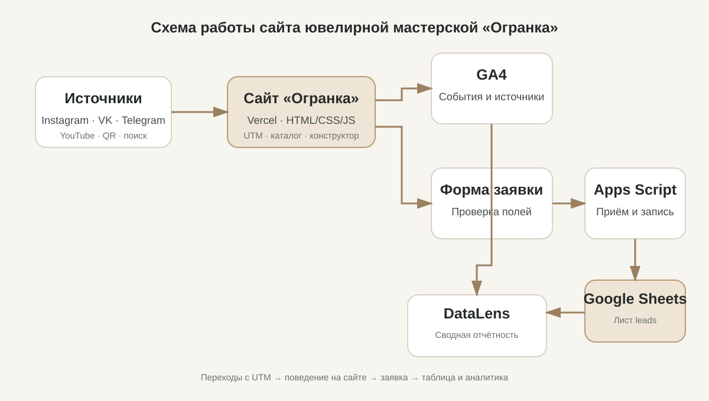

# Описание работы · ТЗ-25/2026 · ювелирная мастерская «Огранка»

**Проект:** сайт ювелирной мастерской «Огранка»  
**Сайт:** https://ogranka.vercel.app  
**Репозиторий:** https://github.com/aleksandra-gur/information-technologi  
**Период подготовки проекта:** октябрь 2026 года

## 1. Задача проекта

Цель проекта — представить услуги ювелирной мастерской в интернете, помочь посетителю выбрать модель обручальных колец, рассчитать предварительную стоимость пары, узнать о гравировке и мастер-классе, а также оставить заявку на примерку.

Сайт должен не только показывать ассортимент, но и собирать обращения с сохранением источника перехода. Для этого предусмотрены UTM-метки, события GA4 и передача заявок в Google Таблицу.

## 2. Схема решения

Пользователь переходит на сайт из поисковой системы, социальной сети, по размеченной ссылке или QR-коду. UTM-метки сохраняются на время сессии. Действия на страницах передаются в Google Analytics 4. Заполненная форма отправляется в Google Apps Script, который записывает заявку в таблицу. Дашборд предназначен для объединения показателей трафика и заявок.

## 3. Структура и страницы сайта

Проект выполнен на HTML, CSS и JavaScript без обязательной сборки. Основные страницы:

- Главная — знакомство с мастерской, популярные модели и переход к записи.
- Каталог — 18 моделей колец, фильтры и просмотр изображений крупно.
- Конструктор — выбор металла, ширины, камня и гравировки с расчётом стоимости.
- Гравировка — ввод текста и предварительный просмотр выбранного шрифта.
- Мастер-класс — описание занятия, стоимость и запись.
- Как узнать размер — калькулятор и таблица размеров в PDF.
- Контакты — форма заявки и способы связи.
- Спасибо — подтверждение отправки формы.
- Политика конфиденциальности и отдельная страница 404.

Вёрстка проверялась на ширинах 375, 768 и 1280 пикселей. В проекте используются отдельные JavaScript-модули для каталога, конструктора, расчёта цены, гравировки, размера кольца, аналитики и формы.

## 4. Каталог и конструктор

В каталоге представлены 18 моделей R-01—R-18. Для каждой модели предусмотрены изображения обычного и увеличенного размера. Пользователь может отфильтровать изделия по металлу, стилю и ширине.

Конструктор позволяет выбрать металл, ширину кольца, наличие камня и гравировку. Цена рассчитывается по параметрам изделия и показывается отдельно за одно кольцо и за пару. Расчёт предварительный; на сайте предусмотрено предупреждение о возможном отличии от итоговой стоимости из-за фактического веса.

Контрольный пример из проекта: золото 585, ширина 3 мм, без камня, с гравировкой — 27 500 ₽ за одно кольцо и 55 000 ₽ за пару.

## 5. Форма заявок и Google Таблица

Форма проверяет обязательные поля и формат телефона. Перед отправкой формируются идентификатор заявки и данные UTM-меток. Запрос передаётся в Google Apps Script. Скрипт записывает данные в лист leads, присваивает заявке дату создания и начальный статус, а также проверяет повторный request_id.

Таблица предназначена для дальнейшей обработки обращений: статус заявки можно менять по мере работы с клиентом. Адрес таблицы: [Ogranka — Leads](https://docs.google.com/spreadsheets/d/1gGxW4NPZy1Jje3vyyhhl-iZ9qCr3vMAf8Kw2TtwhhpU/edit).

Факт успешной работы production-формы и совпадение заявки с событием GA4 следует подтверждать контрольной отправкой и снимками из аккаунтов. Проверка кода не является доказательством полноценной production-интеграции.

## 6. Веб-аналитика GA4

Для сайта создан ресурс GA4 «ОГРАНКА — сайт», Measurement ID: G-37574R54DC. В документации проекта описано 20 событий: автоматические события расширенной статистики и пользовательские события для действий с каталогом, конструктором, гравировкой, калькулятором размера, формой и контактами.

К ключевым событиям проекта относятся:

- generate_lead — успешная отправка заявки;
- contact_click — нажатие на телефон или электронную почту;
- messenger_click — переход в мессенджер.

Список событий, параметры и места вызова приведены в [docs/events.md](events.md). Числовые результаты отчётов в это описание не включены: их необходимо переносить из фактических отчётов GA4 за выбранный период.

## 7. UTM-метки и каналы продвижения

В [docs/utm.csv](utm.csv) подготовлен реестр из 12 размеченных ссылок для Instagram, ВКонтакте, Telegram, YouTube, партнёрских размещений и QR-кода на вкладыше в футляр.

Каждая ссылка содержит источник, тип канала, кампанию и идентификатор размещения. Это позволяет сравнивать переходы из разных публикаций и рекламных материалов. Наличие ссылки в реестре само по себе не означает, что публикация уже размещена: фактические URL публикаций и даты необходимо заполнить после выхода материалов.

## 8. Социальные сети и автоответы

В проекте подготовлены тексты публикаций и сценарии автоответов ManyChat для ключевых слов «РАЗМЕР» и «САМИ». Сценарий «РАЗМЕР» должен направлять пользователя к инструкции по определению размера кольца, а «САМИ» — к странице мастер-класса.

Фактическое подтверждение запуска автоматизаций, ссылки на публикации и переходы со второго аккаунта необходимо хранить в screens/instagram/. До добавления таких доказательств эти пункты не следует описывать как окончательно принятые.

## 9. Отчётность и оценка результата

В проекте предусмотрена аналитическая записка docs/report.md и дашборд DataLens «ОГРАНКА — wedding_2027». Аналитическая записка должна содержать данные о сеансах и источниках трафика, посадочных страницах, событиях, воронке, пути пользователя и количестве заявок.

На момент подготовки этого документа шаблон отчёта содержит поля для внесения результатов. Поэтому выводы о наиболее эффективном канале, конверсии и потерях воронки должны быть сформулированы только после заполнения отчёта реальными данными.

## 10. Использование нейросетей

При подготовке проекта нейросеть использовалась для анализа технического задания, разработки структуры страниц, подготовки текстов, HTML/CSS/JavaScript, иллюстраций, документов и тестирования. Журнал запросов и описание полученных результатов находятся в [docs/prompts.md](prompts.md).

## 11. Итог

Создана основа сайта ювелирной мастерской с каталогом, интерактивным конструктором, калькулятором размера, разделом гравировки и формой обращения. Подготовлены модули аналитики, UTM-реестр, Apps Script и документация.

Окончательная сдача аналитической части требует проверки реальных интеграций и заполнения отчёта. Ссылки на дашборд, опубликованные материалы и подтверждающие скриншоты добавляются после фактической настройки сервисов.
